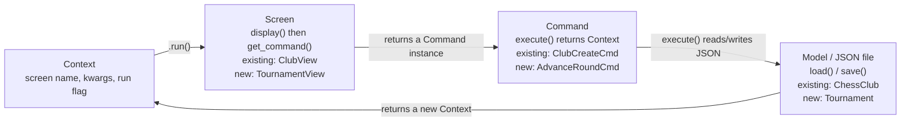
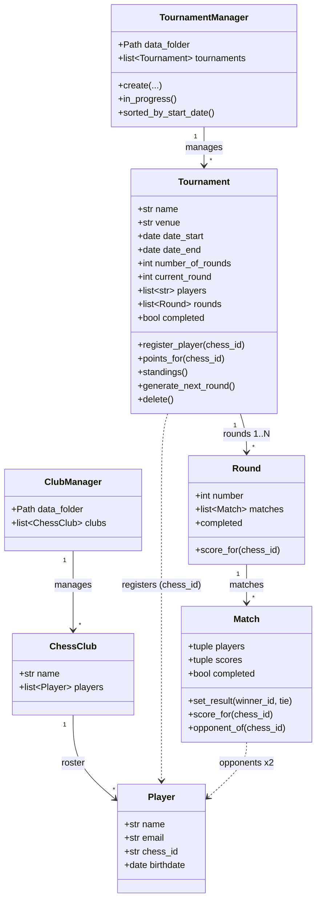
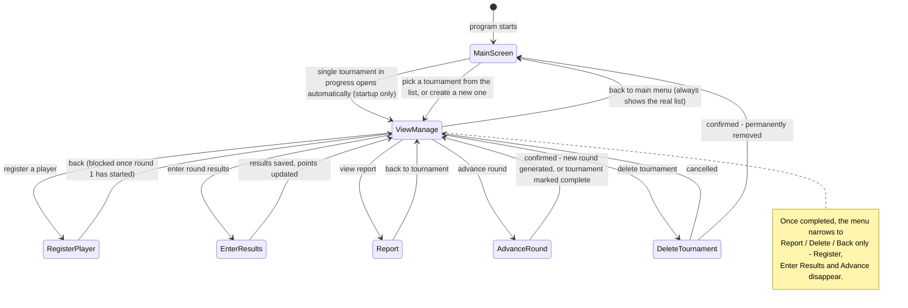

# Castle Chess: Tournament Module Design

**Status: built, tested, and pushed.** This started as a design pass before any code
existed; it now doubles as the architecture reference for what actually shipped. Where
something changed from the original plan (a few things did, based on testing), that's
called out explicitly rather than silently edited away.

This describes how the tournament half of Castle Chess is built on top of the
club/player program that was already working (`manage_clubs.py` and the `models` /
`screens` / `commands` packages). It follows `PreApp_P3_Technical+Specification.pdf`
and `notes/matchmaking.md`.

---

## 1. What this module does

The club organizer's requirements, from her email and the technical spec, boiled down to
five things the program had to do:

| # | Requirement | Status |
|---|---|---|
| 1 | Work fully offline | Done, no networking anywhere in the codebase |
| 2 | Manage club & player data as JSON | Done, in `manage_clubs.py` (pre-existing) |
| 3 | Run a tournament start to finish (create, register, play rounds, results) | Done |
| 4 | Save every change immediately, keep memory and disk in sync | Done |
| 5 | Generate a readable tournament report on demand | Done |

`manage_clubs.py` (called `clubs.py` in the spec) was explicitly **not to be modified**.
The tournament module reuses its architecture instead of inventing a new one.

---

## 2. The foundation it's built on

The existing program is a small state machine: `manage_clubs.py`'s `App` class holds a
`Context`, looks up a `Screen` class for `context.screen`, runs it to get a `Command`,
runs the command to get the next `Context`, and repeats: `while context.run:`. That
loop is the entire application; screens never touch the model layer, and commands never
print anything. The tournament module reuses the same three packages:

- **`models/`**: plain classes, own their JSON load/save, no I/O prompts
- **`screens/`**: `display()` + `get_command()`, no file access
- **`commands/`**: one `execute()` each, returns the next `Context`

### 2.1 The request/response loop



`castle_chess.py` is a copy of `manage_clubs.py`'s `App` class, pointed at the
tournament screens instead of the club ones. Run it with `python castle_chess.py`.

---

## 3. Data model

Four new classes, plus two standalone helper modules that aren't classes at all.
Nothing about `Player` or `ChessClub` changed: a tournament just keeps a list of
`chess_id`s that are already on file in a club's JSON.



**`TournamentManager`** mirrors `ClubManager`: on construction it iterates every
`*.json` file in `data/tournaments/`, builds a `Tournament` from each, and skips (with a
message, not a crash) anything that isn't valid JSON, is missing fields, or is the wrong
shape - this is what protects the whole app from a single bad file on disk.

**`Tournament`** owns the players list, the rounds, and the round counter:
- `register_player(chess_id)`: appends to `players` if not already registered and the
  tournament hasn't started yet (see §5), saves.
- `points_for(chess_id)` / `standings()`: a player's total score, and every player
  ranked by it - computed fresh from match results every time, never stored separately.
- `generate_next_round()`: asks the matchmaking function (§4) for the next round's
  pairings and appends a new `Round` - or, if the round just finished was the last one,
  marks the tournament `completed` instead of generating another round.
- `delete()`: permanently removes the tournament's JSON file (added after the original
  plan - see §7).

**`Round`** is a thin container: a list of `Match`, plus a `completed` property that's
computed from its matches rather than stored (so it can never drift out of sync).

**`Match`** holds two players and their scores.

> **Design decision: score pairs instead of a `winner` field.**
> The sample data in `data/tournaments/*.json` marked a match with a single `winner`
> field, which can't distinguish an unplayed match from a tie: both read
> `winner: null`. `Match` instead stores two `(chess_id, score)` pairs: `1 / 0` for a
> decisive result, `0.5 / 0.5` for a draw. A match's state is then unambiguous, and a
> player's tournament total is just `sum(score for each match played)`, with no separate
> point-bookkeeping code needed anywhere else.

**Two more files in `models/` that aren't classes:**
- `player_search.py`: `all_players()`, `find_by_chess_id()`, `search_by_name()`. Plain
  functions that search across every club's roster, used by the Register screen. Kept
  separate from `ClubManager`/`ChessClub` rather than added to them, since a tournament
  only ever needs to *look up* a player, never modify a club's roster.
- `report.py`: `build_report(tournament)`. Builds the plain-text tournament report
  (name, dates, standings, full round history) as one pure function.

---

## 4. Matchmaking algorithm

From `notes/matchmaking.md`, implemented in `models/matchmaking.py` as
`generate_pairings(tournament)`, which `Tournament.generate_next_round()` calls. It's
kept separate from the `Tournament` class so it stays a pure, testable function with no
side effects.

- **Round 1:** shuffle the registered players, pair them in the shuffled order
  (1st vs 2nd, 3rd vs 4th, ...).
- **Round 2+:** sort players by current tournament points, descending. Walk down the
  sorted list pairing each unpaired player with the *highest-ranked remaining player
  they haven't already played*, falling back to the next-best available opponent if
  every remaining player is a repeat (the spec only asks the system to *try* to avoid
  repeats, not guarantee it).

The actual implementation splits this into three small private functions -
`_standings_with_random_tiebreak()` (builds the ranked list, using a pre-shuffle so
players tied on points end up in random order, per the spec), `_pick_opponent()` (finds
the best non-repeat opponent for one player), and `_already_played()` (checks match
history) - rather than one long function:

```
def generate_pairings(tournament):
    if not tournament.rounds:
        pool = shuffled(tournament.players)
    else:
        pool = standings, with ties broken randomly

    pairs = []
    while pool:
        player = pool.pop(0)
        opponent = best available opponent for player, from pool
        pool.remove(opponent)
        pairs.append((player, opponent))
    return pairs
```

An even number of registered players is required - `generate_pairings` raises
immediately if the count is odd, and the Advance Round screen checks for this before
ever asking the user to confirm (see §5).

---

## 5. Screens & user flow



Each screen keeps the exact two-method shape the existing `BaseScreen` already enforces:

| Screen | Displays | User can | Returns |
|---|---|---|---|
| **Main Screen** | The single in-progress tournament (auto-selected at startup only), or a list of all tournaments sorted by start date descending | Pick a tournament by number, or create one | `NoopCmd("tournament-view", ...)` or `NoopCmd("tournament-create")` |
| **View/Manage Tournament** | Name, dates, venue, rounds (current/total), roster | Register a player, enter results, advance the round, view report, delete the tournament, go back (menu narrows once completed) | Depends on selection |
| **Register a Player** | Full club roster, or search results by chess ID / by name substring (case-insensitive) | Search, then pick a player to register - blocked once the tournament has started | `PlayerRegisterCmd(tournament, player)` |
| **Enter Results** | The current round's matches | Set each match's result: winner/loser, or tie | `EnterResultsCmd(tournament, results)` |
| **Advance to Next Round** | A confirmation prompt (refuses up front if the round isn't finished, the player count is odd, or the tournament's already complete) | Confirm or cancel | `AdvanceRoundCmd(tournament)` on confirm |
| **Delete Tournament** | A confirmation prompt | Confirm or cancel | `TournamentDeleteCmd(tournament)` on confirm |
| **Tournament Report** | Name, dates, standings (points descending), full round-by-round match history | Go back | `NoopCmd("tournament-view", ...)` |

A few behaviors worth calling out explicitly, since some came from testing rather than
the spec itself:

- **Auto-open only happens once, at program startup**, not on every return to the main
  menu. `TournamentListCmd` (used only in `castle_chess.py`'s startup) auto-opens the
  sole in-progress tournament; `TournamentMainCmd` (used everywhere else "back" is
  chosen) always shows the real list. Without this split, there was no way to reach
  "create a new tournament" while one was already in progress - the auto-open rule
  would just keep winning forever.
- **Registration closes once round 1 has started.** This isn't in the spec (it's silent
  on timing) - it's a deliberate choice matching how real Swiss tournaments work, added
  after testing showed a player could otherwise join mid-tournament with zero games
  played while everyone else had several.
- **The View/Manage Tournament menu changes once a tournament is complete** - it no
  longer offers Register, Enter Results, or Advance, since none of those are valid
  anymore. Originally the menu was static regardless of state; this was a usability fix.
- **Register a Player** searches the *club rosters* (via `ClubManager`), not the
  tournament: a player has to already exist in a club file before they can be
  registered for a tournament.
- **Enter Results** is the only screen that changes point totals; it does so by calling
  `Match.set_result()` for each match and saving the tournament immediately after, not
  after the whole round is entered.

---

## 6. Persistence strategy

The spec is explicit: *"the JSON files must be updated every time a change is made...
in-memory objects are always in sync with the JSON files."* Every command that mutates a
`Tournament` (registering a player, recording a match result, advancing a round,
deleting it) calls `tournament.save()` (or `.delete()`) as the last thing it does before
constructing its return `Context`, the same way `ChessClub.update_player()` calls
`self.save()` before returning. Nothing is batched or deferred.

`Tournament.save()` mirrors `ChessClub.save()`: serialize `self` to a dict and
`json.dump()` it to `self.filepath`. Loading mirrors `ChessClub.__init__`: read the file,
rebuild `Round` and `Match` objects from the nested lists, and rebuild the player
reference list.

---

## 7. How it was actually built

The original plan was six phases. That mostly held, with two differences worth being
upfront about: the command/screen list grew as real gaps turned up (no
`TournamentReportCmd` was needed - viewing a report doesn't mutate anything, so it's
just a `NoopCmd`; a `TournamentDeleteCmd`, `TournamentListCmd`, and `TournamentMainCmd`
were needed but weren't in the original list), and a seventh phase happened afterward,
driven entirely by testing the finished thing rather than the spec.

**Phase 1: Data model.**
`models/match.py`, `models/round.py`, `models/tournament.py`,
`models/tournament_manager.py`, plus `models/player_search.py` and `models/report.py`
(both added once the Register and Report screens made clear they were needed - not in
the original plan).

**Phase 2: Matchmaking engine.**
`models/matchmaking.py` - unit-tested directly against a multi-round scenario before
wiring it into `Tournament`.

**Phase 3: Commands.**
`commands/tournament_list.py`, `commands/create_tournament.py`,
`commands/register_player.py`, `commands/enter_results.py`, `commands/advance_round.py`.
(`commands/delete_tournament.py` and `commands/tournament_main.py` came in Phase 7.)

**Phase 4: Screens.**
`screens/tournaments/main.py`, `create.py`, `view.py`, `register.py`, `results.py`,
`advance.py`, `report.py`. (`delete.py` came in Phase 7.)

**Phase 5: Entry point.**
`castle_chess.py`, running the same loop as `manage_clubs.py` against the tournament
screen map.

**Phase 6: Quality & docs.**
`requirements.txt`, a clean `flake8 --max-line-length=119` pass, the `flake8-html`
report under `flake8_report/`, and this repo's `README.md`.

**Phase 7: Fixes found by actually using it.**
Three real gaps surfaced once the built app was tested end-to-end rather than just
read as a plan:
- **Delete a tournament** (`commands/delete_tournament.py`,
  `screens/tournaments/delete.py`) - there was no way to abandon a tournament and start
  over; the only fix was manually deleting a JSON file by hand, which isn't realistic
  for the club organizer this is actually for.
- **Auto-open only at startup** (`commands/tournament_main.py`) - without this,
  "create a second tournament" was unreachable once one was already in progress.
- **Registration closes at round 1**, and **the completed-tournament menu narrows** -
  both covered in §5.

---

## 8. Definition of done

Straight from the spec's "Code Structure and Maintenance" section - all verified, not
just planned:

- [x] Class instances everywhere, no bare dicts standing in for `Player` / `Tournament`
      / `Round` / `Match`
- [x] Screens only display and collect input, never touch a JSON file directly
- [x] `requirements.txt` lists every third-party import, installable with pip
- [x] `flake8 --max-line-length=119` reports zero errors
- [x] `flake8-html` report committed under `flake8_report/`
- [x] `README.md` covers setup, running the program, and regenerating the lint report

---

## 9. Every file, as it actually exists

```
models/
  match.py
  round.py
  tournament.py
  tournament_manager.py
  matchmaking.py
  player_search.py
  report.py
commands/
  tournament_list.py
  tournament_main.py
  create_tournament.py
  register_player.py
  enter_results.py
  advance_round.py
  delete_tournament.py
screens/
  tournaments/
    main.py
    create.py
    view.py
    register.py
    results.py
    advance.py
    delete.py
    report.py
castle_chess.py
requirements.txt
flake8_report/
```
