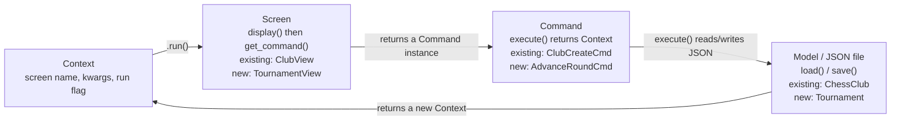
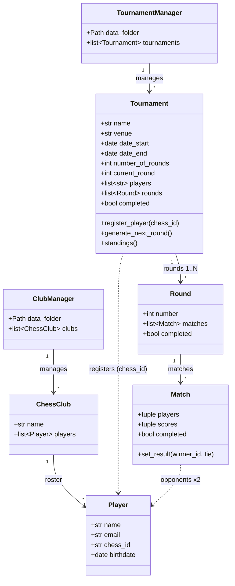
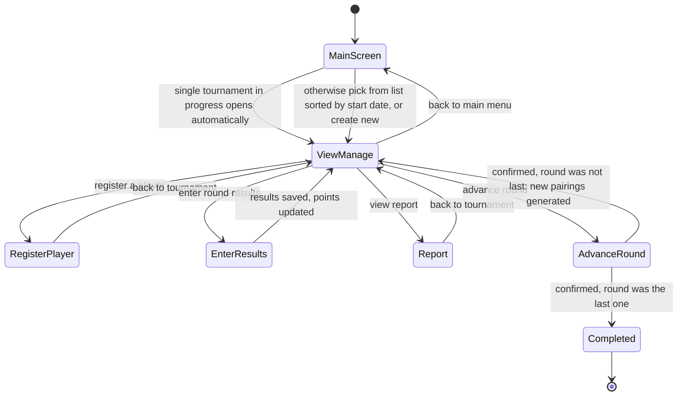

# Castle Chess: Tournament Module Design

**Status: design pass only. Nothing in this document is implemented yet.**

This describes how the tournament half of Castle Chess will be built on top of the
club/player program that's already working (`manage_clubs.py` and the `models` /
`screens` / `commands` packages). It follows `PreApp_P3_Technical+Specification.pdf`
and `notes/matchmaking.md`.

---

## 1. What's being built

The club organizer's requirements, from her email and the technical spec, boil down to
five things the program must do:

| # | Requirement | Status |
|---|---|---|
| 1 | Work fully offline | Already true, no networking anywhere in the codebase |
| 2 | Manage club & player data as JSON | Done, in `manage_clubs.py` |
| 3 | Run a tournament start to finish (create, register, play rounds, results) | To build |
| 4 | Save every change immediately, keep memory and disk in sync | To build |
| 5 | Generate a readable tournament report on demand | To build |

`manage_clubs.py` (called `clubs.py` in the spec) is explicitly **not to be modified**.
The spec says to read it for the code structure and build the tournament side to match
it. Everything below is new code that plugs into the same pattern.

---

## 2. The foundation already in place

The existing program is a small state machine: `manage_clubs.py`'s `App` class holds a
`Context`, looks up a `Screen` class for `context.screen`, runs it to get a `Command`,
runs the command to get the next `Context`, and repeats: `while context.run:`. That
loop is the entire application; screens never touch the model layer, and commands never
print anything. That split (display vs. data) is exactly what the spec's "Code Structure
and Maintenance" section asks for, so the tournament module reuses the same three
packages instead of inventing a new architecture:

- **`models/`**: plain classes, own their JSON load/save, no I/O prompts
- **`screens/`**: `display()` + `get_command()`, no file access
- **`commands/`**: one `execute()` each, returns the next `Context`

### 2.1 The request/response loop



A tournament screen doesn't need a new mechanism, it just needs to be a `Screen`
subclass and hand back a `Command` subclass, and the existing loop in `manage_clubs.py`
(copied into a new `castle_chess.py`) drives it exactly the same way it drives the club
screens today.

---

## 3. Data model

Four new classes. Nothing about `Player` or `ChessClub` changes: a tournament just
keeps a list of `chess_id`s that are already on file in a club's JSON.



**`TournamentManager`** mirrors `ClubManager`: on construction it iterates every
`*.json` file in `data/tournaments/`, builds a `Tournament` from each, and skips (with a
message, not a crash) anything that isn't valid. `.create(name, venue, dates,
number_of_rounds)` builds and saves a new tournament file the same way
`ClubManager.create()` does for clubs.

**`Tournament`** owns the players list, the rounds, and the round counter. Its methods
are where the spec's tournament flow actually lives:
- `register_player(chess_id)`: appends to `players` if not already registered, saves.
- `generate_next_round()`: asks the matchmaking function (§4) for the next round's
  pairings, wraps them as a new `Round`, appends it, bumps `current_round`, saves. Marks
  `completed = True` instead if `current_round == number_of_rounds`.
- `standings()`: returns players sorted by total points, for both the "enter results"
  screen (to pick round 2+ pairings) and the report.

**`Round`** is a thin container: a list of `Match` and a `completed` flag (True once
every match in it has a result).

**`Match`** holds two players and their scores.

> **Design decision: score pairs instead of a `winner` field.**
> The sample data in `data/tournaments/*.json` marks a match with a single `winner`
> field, which can't distinguish an unplayed match from a tie: both read
> `winner: null`. `Match` instead stores two `(chess_id, score)` pairs: `1 / 0` for a
> decisive result, `0.5 / 0.5` for a draw. A match's state is then unambiguous, and a
> player's tournament total is just `sum(score for each match played)`, with no separate
> point-bookkeeping code needed anywhere else.

---

## 4. Matchmaking algorithm

From `notes/matchmaking.md`, implemented as a function (e.g.
`models/matchmaking.py:generate_pairings(tournament)`) that `Tournament.generate_next_round()`
calls. It's kept separate from the `Tournament` class so it stays a pure, testable
function with no side effects:

- **Round 1:** shuffle the registered players, pair them in the shuffled order
  (1st vs 2nd, 3rd vs 4th, ...).
- **Round 2+:** sort players by current tournament points, descending. Walk down the
  sorted list pairing each unpaired player with the *highest-ranked remaining player
  they haven't already played*, falling back to the next-best available opponent if
  every remaining player is a repeat (the spec only asks the system to *try* to avoid
  repeats, not guarantee it).

```
def generate_pairings(tournament):
    if tournament.current_round == 0:
        pool = shuffle(tournament.players)
    else:
        pool = sort_by_points_desc(tournament.players)

    pairs = []
    while pool:
        player = pool.pop(0)
        opponent = next(
            (p for p in pool if not already_played(tournament, player, p)),
            pool[0],
        )
        pool.remove(opponent)
        pairs.append((player, opponent))
    return pairs
```

`already_played(tournament, a, b)` scans every prior round's matches for the pair, a
handful of comparisons even for a long tournament, so there's no need to cache it.
Colour assignment (white/black) is explicitly out of scope per the spec ("sorted among
the players, no need to implement any color balancing").

---

## 5. Screens & user flow



Each screen keeps the exact two-method shape the existing `BaseScreen` already enforces:

| Screen | Displays | User can | Returns |
|---|---|---|---|
| **Main Screen** | The single in-progress tournament (auto-selected), or a list of all tournaments sorted by start date descending | Pick a tournament by number, or create one | `NoopCmd("tournament-view", ...)` or `NoopCmd("tournament-create")` |
| **View/Manage Tournament** | Name, dates, venue, rounds (current/total), roster | Register a player, enter results, advance the round, view report, go back | Depends on selection, same pattern as `ClubView` |
| **Register a Player** | Full club roster, or search results by chess ID / by name substring (case-insensitive) | Search, then pick a player to register | `PlayerRegisterCmd(tournament, player)` |
| **Enter Results** | The current round's matches | Set each match's result: winner/loser, or tie | `EnterResultsCmd(tournament, results)` |
| **Advance to Next Round** | A confirmation prompt | Confirm or cancel | `AdvanceRoundCmd(tournament)` on confirm |
| **Tournament Report** | Name, dates, standings (points descending), full round-by-round match history | Go back | `NoopCmd("tournament-view", ...)` |

A few spec details worth calling out explicitly since they're easy to miss in the boxes
above:

- The **Main Screen**'s auto-open behaviour means `TournamentListCmd` has to check *how
  many* tournaments have `completed == False` before deciding which `Context` to
  return: one in-progress tournament skips straight to `tournament-view`; zero or
  several fall through to the list.
- **Register a Player** searches the *club rosters* (via `ClubManager`), not the
  tournament: a player has to already exist in a club file before they can be
  registered for a tournament.
- **Enter Results** is the only screen that changes point totals; it does so by calling
  `Match.set_result()` for each match and saving the tournament immediately after each
  one, not after the whole round is entered (see §6).

---

## 6. Persistence strategy

The spec is explicit: *"the JSON files must be updated every time a change is made...
in-memory objects are always in sync with the JSON files."* Concretely, that means every
command that mutates a `Tournament` (registering a player, recording one match result,
advancing a round) calls `tournament.save()` as the last thing it does before
constructing its return `Context`, the same way `ChessClub.update_player()` calls
`self.save()` before returning. Nothing is batched or deferred, so a crash or Ctrl-C
between actions never loses more than the keystrokes the user hasn't submitted yet.

`Tournament.save()` mirrors `ChessClub.save()`: serialize `self` to a dict and
`json.dump()` it to `self.filepath`. Loading mirrors `ChessClub.__init__`: read the file,
rebuild `Round` and `Match` objects from the nested lists, and rebuild the player
reference list.

---

## 7. Build order

Six phases, played in order: each one depends on state the phase before it put in
place.

**Phase 1: Data model.**
Add `Match`, `Round`, and `Tournament` to `models/`, plus a `TournamentManager` that
loads every file in `data/tournaments/` the same way `ClubManager` loads
`data/clubs/`. Files: `models/match.py`, `models/round.py`, `models/tournament.py`,
`models/tournament_manager.py`.

**Phase 2: Matchmaking engine.**
Implement `generate_pairings()` per §4, and unit-test it directly against
`data/tournaments/completed.json` and `in-progress.json` (real sample data already in
the repo) before wiring it into `Tournament`. File: `models/matchmaking.py`.

**Phase 3: Commands.**
One command per user action from the table in §5, all on the existing
`BaseCommand`/`Context` contract: `TournamentCreateCmd`, `PlayerRegisterCmd`,
`EnterResultsCmd`, `AdvanceRoundCmd`, `TournamentReportCmd`.

**Phase 4: Screens.**
Build the six screens from §5 under `screens/tournaments/`, reusing `BaseScreen`'s
`input_string` / `input_regexp` / `input_chess_id` helpers for player search and result
entry, exactly as `PlayerEdit` already does for club players.

**Phase 5: Entry point.**
`castle_chess.py` is a copy of `manage_clubs.py`'s `App` class pointed at a
`SCREENS` map for the tournament screens instead of the club ones, started with
`python castle_chess.py`, per the spec's requirement that the program run as
`python <program name>.py`.

**Phase 6: Quality & docs.**
`requirements.txt` (pip-installable, listing anything beyond the standard library),
`flake8` run with `--max-line-length=119`, an `flake8-html` report committed under
`flake8_report/`, and a `README.md` that documents setup, running the program, and
regenerating the lint report.

---

## 8. Definition of done

Straight from the spec's "Code Structure and Maintenance" section:

- [ ] Class instances everywhere, no bare dicts standing in for `Player` / `Tournament`
      / `Round` / `Match`
- [ ] Screens only display and collect input, never touch a JSON file directly
- [ ] `requirements.txt` lists every third-party import, installable with pip
- [ ] `flake8 --max-line-length=119` reports zero errors
- [ ] `flake8-html` report committed under `flake8_report/`
- [ ] `README.md` covers setup, running the program, and regenerating the lint report

---

## 9. New files at a glance

```
models/
  match.py
  round.py
  tournament.py
  tournament_manager.py
  matchmaking.py
commands/
  create_tournament.py
  register_player.py
  enter_results.py
  advance_round.py
  tournament_report.py
screens/
  tournaments/
    main.py
    view.py
    register.py
    results.py
    advance.py
    report.py
castle_chess.py
requirements.txt
flake8_report/
```
